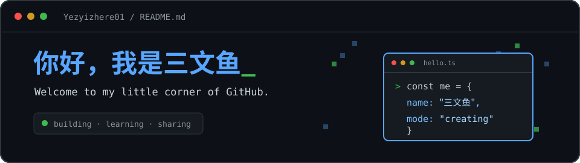

 

<samp>👋 你好，我是三文鱼。欢迎来到我的 GitHub 小角落。</samp>

## ABOUT ME · 关于我

<table>
  <tr>
    <td width="62%" valign="top">
      <h3>✨ 一点自我介绍</h3>
      
这里是我的个人主页。我会把正在做的项目、学到的新东西，以及值得记录的灵感慢慢放在这里。也希望可以认识更多志同道合的人，一起进步🎉

      
📫 <b>找到我</b>：
            
 E-mail: <code>2631266284@qq.com</code>

            
 Rednote: <code>诶你吃三文鱼吗</code>

    </td>
    <td width="38%" align="center" valign="middle">
      
    </td>
  </tr>
</table>

 

## CONTRIBUTIONS · 提交轨迹

  <picture>
    <source media="(prefers-color-scheme: dark)" srcset="https://raw.githubusercontent.com/Yezyizhere01/Yezyizhere01/output/github-contribution-grid-snake-dark.svg" />
    <source media="(prefers-color-scheme: light)" srcset="https://raw.githubusercontent.com/Yezyizhere01/Yezyizhere01/output/github-contribution-grid-snake.svg" />
    
  </picture>

   
  Thanks for stopping by ✦ 感谢来访

